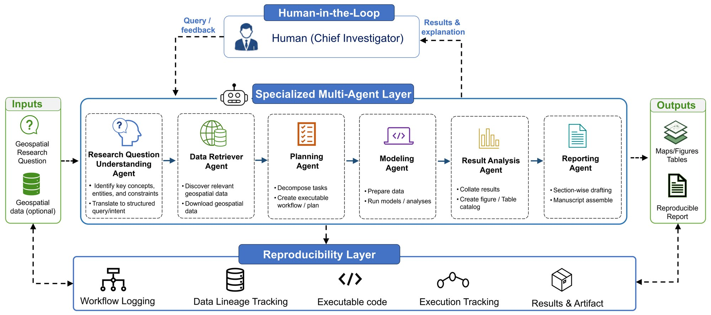

#  GIS Co-Scientist

GIS Co-Scientist is a human-AI collaborative framework that supports geospatial scientific inquiry. It takes a research question, **plans** the analytical steps, **executes** them, and **generates a first draft manuscript**. With a **human in the loop**, it pauses at key stages so you can review, edit, and approve its work before it continues. The same interface also supports standalone **data retrieval** and **spatial analysis**.

For more details, refer to the published article:

Temitope Akinboyewa and Zhenlong Li. 2026. *"GIS Co-Scientist: a human-AI collaborative framework for autonomous geospatial scientific inquiry."* Geo-spatial Information Science. https://doi.org/10.1080/10095020.2026.2764024

> [!IMPORTANT]
> **Case studies:** The research questions, conversation records, workflows, figures, and manuscripts of the case studies are available on the [project page](https://autonomousgis-agsi.github.io/AGSI/#case-studies).

# Working modes

- **Research:** goes from a research question to a first draft manuscript.
- **Data Retrieval:** finds and downloads geospatial data from a plain-language request.
- **Spatial Analysis:** plans and runs a geoprocessing workflow.
- **Chat:** answers GIS questions.

# Getting started

## Desktop app (recommended)

- [Download the installer](https://autonomousgis-agsi.github.io/AGSI/desktop-install.html) for Windows or macOS and follow the steps on the page.
- Open the app and add your OpenAI API key in `Settings`.

## WebUI

- Open [www.gis-coscientist.online](https://www.gis-coscientist.online/) in your browser.
- Add your OpenAI API key in `Settings`.

## API key

Use your own [OpenAI API key](https://platform.openai.com/api-keys). A [GIBD key](https://www.gibd.online) is only a backup if you want to test or try out the system.

# User Manual

The User Manual is available [here](https://autonomousgis-agsi.github.io/AGSI/user_manual).

# Demonstration

### Data Retrieval mode

### Spatial Analysis mode

### Research mode

Find more examples in the [video playlist](https://youtube.com/playlist?list=PL6ON3gdLloDE_aLyFjj4X7EYKDDdAfJi2) and on the [project page](https://autonomousgis-agsi.github.io/AGSI/#demos).
