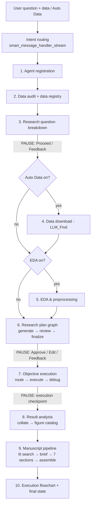

# Research Mode Workflow: from Question to Manuscript

This document describes what happens when a user submits a research question in **Research** mode in the GIS Co-Scientist Web UI. It covers every stage from intent routing to the assembled manuscript. It also lists the files each stage writes and the points where the run pauses for the user.

The orchestration code is in `WebUI/agm_workflow.py`. Each stage calls into a specialist agent under `agents/`.

---

## 1. Overview



The workflow runs as **three resumable segments** separated by user gates:

| Segment | Entry function | Ends at |
|---|---|---|
| A | `agm_workflow_handler` | Task Breakdown pause |
| B | `continue_after_rq_breakdown_stream` → `_post_rq_breakdown_pipeline` | Research-plan approval pause |
| C | `continue_after_approval_stream` | Workflow complete |

At each pause the full context (`ctx`) is serialised to disk with `save_workflow_state`. A browser reload, or a request served by a different worker, can resume from that snapshot. In **autonomous mode** the frontend clicks Proceed/Approve automatically and the execution checkpoint is skipped.

Every long-running stage uses the same pattern. The agent runs in a background thread and streams tokens and events through a `queue.Queue`. The generator yields those items to the browser as SSE events, and it checks `is_cancelled()` between items.

---

## 2. Entry and Intent Routing

**Function:** `smart_message_handler_stream` (`WebUI/agm_workflow.py:1350`)

1. **Spatial condition.** The function resolves the experimental arm (`B0` by default; also `B1`, `B2`, `B3`, `P`, the ablations and `B3+structure`) from `agents/spatial_reasoning/conditions.py`. Any condition other than B0 requires Research mode.
2. **Model selection.** The UI's model and reasoning effort are pushed to `utils.agm_helper.set_ui_model`. A user-supplied API key is copied into `os.environ` so background threads can read it.
3. **Intent.** In Research mode the intent is set manually (`"research"`, confidence 1.0), so no LLM call is made. `research_no_planning` is the same workflow with `ablation="no_planning"`.
4. **Routing:**
   - Files uploaded → `agm_workflow_handler`.
   - No files but **Auto Data** on → `agm_workflow_handler` with `data_download_mode=True`.
   - No files and Auto Data off → the user is asked to upload data or turn on Auto Data.

---

## 3. Segment A: Understanding the Question

**Function:** `agm_workflow_handler` (`WebUI/agm_workflow.py:1730`)

### 3.1 Context initialisation
`init_workflow_context` creates `ctx` with a `task_id`, a per-task output folder (`Outputs/<task_id>/`), the datasets, and these settings: `interactive_code`, `enable_eda`, `autonomous_mode`, `data_download_mode`, `ablation`, `spatial_condition` and `exploration_data`. Settings live in `ctx["settings"]` so they survive both pauses.

### 3.2 Step 1: Agent registration
`register_agent()` registers the specialist agents (DataAgent, ModelingAgent, etc.) with the `TaskManager`. The step router later picks from this registry.

### 3.3 Step 2: Data audit and data registry
- **Agent:** `DataAgent.audit_datasets` (`agents/data_agent/agm_data_agent.py:168`)
- For each file: sniff the format (vector, raster or tabular), open it, and record CRS, shape, columns and validity.
- Output: `ctx["artifacts"]["data_audit_records"]`.
- Every file that audits successfully is peeked with `helper._peek_file` (columns, sample head, shape) and added to the **data registry**, `ctx["artifacts"]["data_registry"]`. The registry is the single list of available data that every later agent reads.

### 3.4 Step 3: Research question breakdown
- **Agent:** `RQUnderstandingAgent.rq_breakdown` (`agents/rq_understanding_agent/agm_rq_understanding_agent.py:66`)
- One streamed JSON-mode LLM call. Inputs are the question and a compact line per registry entry. The system prompt is `utils/prompts.rq_breakdown_system_prompt`.
- Output schema (saved to `rq_breakdown.json` and `ctx["artifacts"]["rq_breakdown"]`):

```json
{
  "title": "...",
  "intent": "...",
  "brief_description": "...",
  "category": "Descriptive | Explanatory | ...",
  "scale": {"temporal_scale": "...", "spatial_scale": "..."},
  "data_requirement": ["..."],
  "data_available_sufficiency": "Yes/No - ...",
  "data_available": ["..."],
  "data_requests": ["..."] | null
}
```

`data_requests` drives the optional download stage. `intent`, `category`, `scale` and `data_requirement` are passed to the planner.

### 3.5 Gate 1: Task Breakdown review
The workflow **stops** (`workflow_phase: "rq_breakdown_paused"`). The UI shows the breakdown and the Data Availability card with two buttons:

- **Provide Feedback** → `revise_rq_breakdown_stream`. The LLM edits only what the feedback asks about, the on-disk snapshot is updated, and the card is redrawn.
- **Proceed** → `/api/rq-breakdown/proceed/<task_id>` → Segment B. Proceed can also skip the download, or force it if the user turned Auto Data on from the missing-data prompt.

---

## 4. Segment B: Data and Planning

**Function:** `_post_rq_breakdown_pipeline` (`WebUI/agm_workflow.py:2292`)

### 4.1 Step 4 (optional): Data download (LLM_Find)
Runs only when `data_download_mode` is on and the breakdown produced `data_requests`.

- **Agent:** `DataAgent.data_download` → `DataRetrieverAgent` (handbook-driven retrieval).
- For each data request:
  1. **Source selection.** The LLM picks a source from the handbooks and reports a confidence score. The user sees a confirmation panel with these actions: Proceed, Change source, Retry, Abort, **Always Proceed**, or **Generate & Use New Skill**.
     - In autonomous mode the prompt is skipped. If the source is unrecognised, a new handbook is generated automatically (Handbook Generator).
     - A **missing or rejected API key always pauses**, even in autonomous mode. Keys the user enters are kept in `ctx["_data_source_keys"]` and reused.
  2. **Skill synthesis** (if needed) streams to its own card. Later output for that request goes to a continuation card.
  3. Code generation and execution download the data. Delivered files are split into real datasets and the script's scratch files (`classify_delivered_files`).
  4. **Post-download review** (interactive runs only): the user checks what was delivered before the run continues.
- Failed requests (interactive): `_handle_failed_downloads_interactive` lets the user retry, skip, or abort.
- New dataset files are appended to `ctx["datasets"]`, **re-audited**, added to the data registry with `source: "downloaded"`, and copied into `WebUI/uploads/<task_id>/` so they appear as map layers.

### 4.2 Step 5 (optional): EDA and preprocessing
Runs only when `enable_eda` is on.

- **Agent:** `DataAgent.eda` is a tool-using loop of up to 20 iterations. It explores, cleans and preprocesses the data.
- Actions that need approval are sent to the UI on an approval queue. The tool thread blocks until the user answers.
- Plots, cleaned files and reports in the output folder are shown as an "EDA" step result. The context is kept so `/api/eda-explore` can answer follow-up exploration requests.

### 4.3 Step 6: Research plan generation
- **Graph:** `research_plan_generator.build_serial_graph` (`agents/task_manager/research_plan_generator.py:595`), a linear LangGraph.

```
[state_assumptions] → generate_research_plan → review_research_plan → [spatial_grounding] → finalize_research_plan
```

The bracketed nodes are added only for spatial conditions that use them (see §4.4).

| Node | What it does | Output |
|---|---|---|
| `generate_research_plan` | Agentic loop (up to 10 tool turns). The LLM explores the datasets with research-design tools and drafts objectives, hypotheses and steps. Under B1–B3 the spatial knowledge base is added to the prompt or tools. | `research_plan.json`, `spatial_knowledge_access.json`, `planner_input` record |
| `review_research_plan` | Agentic loop (up to 8 tool turns). Checks the draft against the real data: column names, join keys, step connectivity. Returns a corrected plan and a `review_summary`. If the review returns no usable plan, the draft is kept. | `research_plan_review.json` |
| `finalize_research_plan` | No LLM call. Removes review metadata and adds the title, question and intent. Runs the spatial `on_finalize` hook. Then **resolves node paths**: each step's `input_nodes` are mapped to registry files or earlier steps' outputs, and each `output_node` to a fixed path in `Outputs/<task_id>/`. | `research_plan_final.json` → `ctx["artifacts"]["research_plan_final"]` |

**Plan structure** (the input to execution):

```json
{
  "title": "...", "research_question": "...", "research_intent": "...",
  "objectives": [
    {
      "number": 1, "title": "...", "hypothesis": "...",
      "steps": [
        {
          "step_number": 1, "description": "...",
          "operation_type": "...", "operation": "...",
          "depends_on": [], "input_nodes": ["..."], "output_node": "...",
          "input_node_paths": {"...": "path"}, "output_node_path": "path"
        }
      ]
    }
  ]
}
```

`research_plan_viz` writes the HTML plan view and flowchart, which are served at `/api/research-plan/<task_id>`.

### 4.4 Spatial-reasoning nodes (conditions P, P-ablations, B3+structure)
From `agents/spatial_reasoning/pipeline.py`:

- **(a) `state_assumptions`** (before planning): states hypotheses with **structured, locked spatial assumptions**: analysis unit / MAUP, independence of observations, and global vs. local relationship. The planner must test these hypotheses (`planner_addendum`).
- **(b) Diagnostics** (in `spatial_grounding`): on an exploration split of the data, runs residual spatial dependence (queen/kNN weights), aggregation sensitivity, and local variation. The plan is then revised against this evidence.
- **(c) Spatial critic** (in `spatial_grounding`): up to 2 rounds (`critic.MAX_ROUNDS`). It approves the plan or asks for a revision and may request more diagnostics. Only major issues change the plan; minor ones are recorded.
- `on_finalize` puts back any locked hypotheses that the reviewer dropped and writes the spatial assumptions report.
- Files: `spatial_diagnostics.json`, `plan_revisions.json`, `spatial_critic.json`, `spatial_condition.json`.

### 4.5 Gate 2: Research plan approval
The workflow **stops** with `result_type: "research_plan_pending_approval"`. The user can:

- **Edit inline** (`update_research_plan`): change titles, hypotheses and step text; add or delete steps. Deleting a step calls `regen_plan_after_step_delete`, where an LLM repairs the objective's `depends_on`, `input_nodes` and `output_node` and renumbers the steps. Paths are then resolved again.
- **Provide feedback** (`revise_research_plan_stream`): the LLM revises the plan.
- **Approve** → Segment C.

> **No-planning ablation:** stages 6 and gate 2 are skipped. `build_no_planning_plan` stores a hidden one-step placeholder plan, and execution starts in the same stream with every step pinned to the ModelingAgent.

---

## 5. Segment C: Execution, Analysis, and Writing

**Function:** `continue_after_approval_stream` (`WebUI/agm_workflow.py:4933`)

`ctx` is restored from memory, or from disk as a fallback. The plan is marked approved, and any hypothesis edits made at approval are recorded (`record_checkpoint_edits`).

### 5.1 Step 7: Objective execution
- **Graph:** `objective_executor.build_serial_graph` (`agents/task_manager/objective_executor.py:240`). One graph is compiled once and **invoked once per objective**, in order.

```
route_steps → step_execution → (errors left?) → step_debugger → END
```

**`route_step_to_agent`.** One LLM call per objective. Each step's `description`, `operation_type` and `operation` are matched against the registered agents' descriptions and a task-class reference (data collection, processing, descriptive, statistical, spatial, visualization, ML, synthesis). The result for each step is `agent_name`, `reasoning`, `execution_notes` and `task_complexity` (simple / medium / complex). An unknown agent name falls back to the first registered agent.

**`step_executor`.** Runs the steps in order:
1. **Dependency check.** If any `input_nodes` or `depends_on` point to a failed or empty upstream step, the step is **skipped** and marked tainted, so the skip carries forward to its dependants. This prevents cascading errors.
2. **Code generation and execution.** The simple, medium and complex pipelines currently all route to the same path: `agent.handle_generate_and_execute_code_for_simple_operation`. The agent (usually the ModelingAgent or DataAgent) generates Python in a tool loop of up to 10 iterations, using the step's resolved input and output paths, then runs it.
3. **Interactive code mode** (`interactive_code` on): the generated code is sent to the UI before it runs. The user can approve, edit, or give feedback, for up to 5 rounds (`generate_code_for_operation_interactive`).
4. **Inline debugger.** If the code fails, `run_debugger` → `error_debug` (`agents/task_manager/debugger.py`) investigates with tools. It can inspect columns, check the CRS, list files, read earlier steps' outputs, install packages and run code. It makes up to **2 repair attempts × 20 tool iterations**, and the fixed code is run again.
5. **Output reconciliation** (`_reconcile_step_outputs`): if the code saved its output under a different name than the plan expected, the actual file is matched and the paths of downstream steps are updated.
6. A `step_result` event (status, code, output, created files) is sent to the UI. State is saved to disk after each step (`_persist_callback`).

**`step_debugger`.** Reached only if errors remain after inline repair. It logs the unresolved failures for human review and does not change any code.

Results: `ctx["artifacts"]["step_execution_results"]`, `step_routing`, `objective_results`, and code files and outputs in `Outputs/<task_id>/`.

### 5.2 Gate 3: Execution checkpoint
An `execution_checkpoint` event lists every step's status. Unless the run is autonomous, the workflow **blocks** (and sends an SSE heartbeat every 10 s). The user can:
- Re-run or edit individual steps (`rerun_step_stream`, `rerun_cascade_stream` for a step and its dependants), then click **Update Status** to redraw the summary.
- Click **Proceed** to start result analysis.

### 5.3 Step 8: Result analysis
- **Graph:** `build_result_analysis_graph` (`agents/result_analysis_agent/result_analysis_graph.py`)

```
collate_results → prepare_figures
```

- **`collate_results`** (`result_analyzer.collate_results`): clears cached results from earlier runs, then gathers each objective's step outputs, metrics and files into `ctx["artifacts"]["collated_results"]`.
- **`prepare_figures`** (`figure_catalog_v2.build_catalog`): builds the **figure/table catalog** from the manifest that steps write as they record figures, tables and data-to-visualise files. Intermediate files can be promoted into or demoted out of the catalog. The catalog is sent to the UI as thumbnails (`figure_catalog` event).

Both outputs feed the manuscript writers directly.

### 5.4 Step 9: Manuscript generation
- **Graph:** `build_manuscript_pipeline` (`agents/reporting_agent/manuscript_pipeline.py:711`)

**Preparation (before the graph runs):**
1. **Batch literature search** (`_batch_literature_search`): 2–4 Semantic Scholar queries built from the question and objective titles, up to 15 papers with duplicates removed → `pre_searched_literature`.
2. **Literature curation** (`_curate_and_expand_literature`): tags each paper as *foundational*, *methodological*, *regional* or *gap_evidence*, then runs up to 3 follow-up searches to fill roles with too few papers.
3. **Manuscript brief** (`manuscript_tools.build_manuscript_brief`): built once. It contains full step outputs, output-file statistics, the figure catalog, and every paper pre-registered as a citation. Because of the brief, most sections need only one LLM call.

Steps 1 and 2 are skipped if they fail; the writers can still search for literature themselves.

**Section graph** (`agents/reporting_agent/section_writers.py`):

```
title_abstract → introduction → methodology → results → discussion → conclusion → references → assemble
```

| Section | Writer mode | Notes |
|---|---|---|
| Title & Abstract | single call | |
| Introduction | agentic, ≤3 iterations | literature tools; builds the gap argument from the curated papers |
| Methodology | agentic, ≤2 iterations | describes the plan, data and methods |
| Results | agentic, ≤3 iterations | can compute extra statistics; refers to the catalog's figures and tables |
| Discussion | agentic, ≤3 iterations | literature tools; compares findings with prior work |
| Conclusion | single call | |
| References | `compile_references` | scans the assembled body for citation placeholders and builds the reference list |

Every section writer runs inside `_run_section_safely`:
- On failure, a placeholder is inserted and the pipeline **continues**.
- Each section is saved to `manuscript_sections/<section>.md` and sent to the UI as soon as it is written.
- Every writer receives the sections already drafted, so later sections stay consistent with earlier ones.

**`assemble`:**
- Joins the sections in order. Under the proposed method a **Spatial Assumptions** section goes between Results and Discussion.
- Renumbers figures and tables in reading order, removes references to figures that don't exist, and normalises tables.
- Writes `manuscript.md` and converts it to **DOCX and PDF** (`report_converter.convert_md_report`).
- Stores **input fingerprints** for each section (rq_plan, execution). A later **Rerun Manuscript** (`rerun_manuscript_stream` / `build_update_manuscript_pipeline`) rewrites only the sections whose inputs changed.

### 5.5 Step 10: Wrap-up
- `generate_execution_flowchart` renders a flowchart of what actually ran. Failures here are not fatal.
- Final state is saved with `workflow_phase: "completed"` and step counts (completed / errors / skipped). The live `ctx` is kept so steps, result analysis, or manuscript sections can be re-run afterwards.
- A final `workflow_complete` result is sent with the plan, execution summary, and manuscript paths (`.md`, `.docx`, `.pdf`).

---

## 6. User Touchpoints at a Glance

| Point | Interactive mode | Autonomous mode |
|---|---|---|
| Task Breakdown | Proceed / Feedback | auto-Proceed |
| Data source selection (per request) | confirm / change / generate skill / Always Proceed | auto; **pauses only for missing or invalid API keys** |
| Post-download review | review delivered files | skipped |
| Failed downloads | retry / skip / abort | continue with what succeeded |
| EDA approvals | approve tool actions | — (EDA is opt-in) |
| Research plan | edit / feedback / approve | auto-approve |
| Code review (if `interactive_code`) | approve / edit / feedback (≤5 rounds) | — |
| Execution checkpoint | re-run steps / proceed | skipped |
| After completion | re-run step, assembly, result analysis, or stale manuscript sections | same |

---

## 7. Output Folder (`Outputs/<task_id>/`)

| File | Stage |
|---|---|
| `spatial_condition.json` | start |
| `rq_breakdown.json` | RQ breakdown |
| downloaded datasets (also copied to `WebUI/uploads/<task_id>/`) | data download |
| EDA plots / cleaned data | EDA |
| `research_plan.json`, `research_plan_review.json`, `research_plan_final.json`, plan HTML | planning |
| `spatial_knowledge_access.json`, `spatial_diagnostics.json`, `plan_revisions.json`, `spatial_critic.json`, assumptions report | spatial conditions |
| step code files, step outputs (`<output_node>.*`), figures, figure manifest | execution |
| `manuscript_sections/*.md` | manuscript (checkpoints) |
| `manuscript.md`, `manuscript.docx`, `manuscript.pdf` | manuscript |
| execution flowchart | wrap-up |

Workflow state snapshots for resuming are kept separately (`_get_state_dir`). They are updated at each gate and after every executed step.

---

## 8. Key Source Files

| Concern | File |
|---|---|
| Orchestration, gates, SSE streaming | `WebUI/agm_workflow.py` |
| HTTP endpoints | `WebUI/app.py` |
| Data audit, download, EDA, simple-step code | `agents/data_agent/agm_data_agent.py`, `DataRetrieverAgent.py`, `handbook_generator.py` |
| Question breakdown | `agents/rq_understanding_agent/agm_rq_understanding_agent.py` |
| Research plan graph | `agents/task_manager/research_plan_generator.py` |
| Step routing / execution graph | `agents/task_manager/objective_executor.py` |
| Agentic debugger | `agents/task_manager/debugger.py` |
| Modeling code generation | `agents/modeling_agent/agm_modeling_agent.py` |
| No-planning ablation | `agents/task_manager/ablation.py` |
| Spatial conditions & proposed method | `agents/spatial_reasoning/` (`conditions.py`, `pipeline.py`, `assumptions.py`, `diagnostics.py`, `critic.py`, `revision.py`) |
| Result collation & figure catalog | `agents/result_analysis_agent/result_analysis_graph.py`, `result_analyzer.py`, `figure_catalog_v2.py` |
| Manuscript pipeline & writers | `agents/reporting_agent/manuscript_pipeline.py`, `section_writers.py`, `section_prompts.py`, `manuscript_tools.py` |
| DOCX/PDF conversion, flowchart | `agents/result_analysis_agent/report_converter.py`, `execution_flowchart.py` |

---

## 9. Notes on Current Behaviour

- The **simple / medium / complex** pipelines in `objective_executor.py` currently run the same code path. The complexity label is recorded but does not yet change how a step runs.
- Every LLM call takes its model and reasoning effort from `utils/llm_models.toml` by a unique name (e.g. `research_plan.generate`, `execution.debugger`, `manuscript.section_agentic`), not from the UI's selectors. All entries are currently `gpt-6-luna`, most at `low` effort. `tests/test_llm_models.py` fails if a call hard-codes a model or effort, or uses a name missing from the file.
- `gpt-6-luna` rejects tools combined with reasoning, so its tool-using calls (plan generate/review, debugger, EDA, agentic manuscript sections) are always sent `reasoning_effort="none"`, whatever the file says.
- `result_presentation.py` and `result_discussion.py` are not imported anywhere in `agents/`, `WebUI/` or `utils/`. Results and Discussion are written by the manuscript section writers from the collated results and the brief.
